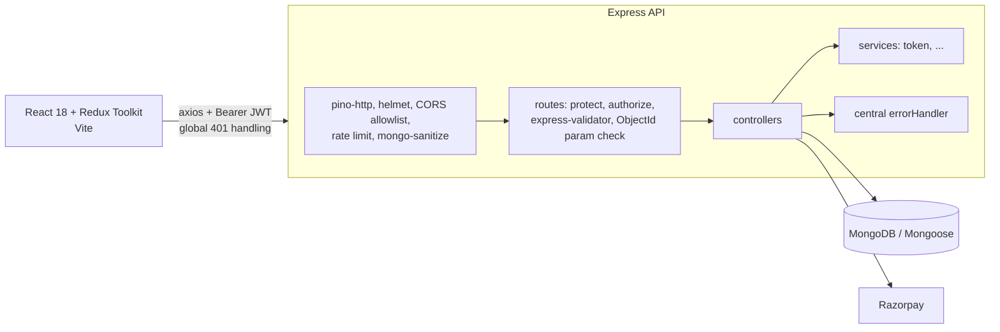

# Hospital Management System (HMS)

Role-based hospital management platform: appointments, patients, doctors, staff, beds and admissions, EMR, lab, pharmacy, billing (Razorpay), reviews and notifications.

## Architecture



Request flow: `app.js` middleware stack, then `routes/index.js` (mounts every router under `/api` and registers ObjectId param validation), then per-route `protect` (JWT plus live user lookup), `authorize(...roles)`, validators, controller. Controllers throw or call `next(err)`; `middlewares/errorMiddleware.js` maps Mongoose, JWT and Mongo duplicate-key errors to consistent JSON: `{ success: false, message, details? }`.

```
backend/   app.js (express app) · server.js (bootstrap, graceful shutdown) · config/ · routes/ · controllers/
           middlewares/ · validators/ · services/ · models/ · utils/ · __tests__/
client/    src/{components,pages,features(redux slices),routes,utils} · tests/
```

## Setup

```bash
# 1. API
cd backend && cp .env.example .env     # set MONGO_URI and a 32+ char JWT_SECRET
npm install && npm run dev             # http://localhost:5000/api/health

# 2. Web
cd client && cp .env.example .env && npm install && npm run dev
```

Docker: `JWT_SECRET=<32+ chars> docker compose up --build` (web on :5173, API on :5000, Mongo included).

Tests: `npm test` at the repo root (Jest + Supertest for the API, `node --test` for the client). Lint: `npm run lint`. CI (`.github/workflows/ci.yml`) runs tests, lint, build and Docker builds.

## Design decisions

- **Central error pipeline.** Controllers never format 500s themselves; one handler guarantees a consistent shape and hides internals in production.
- **Validation at the edge.** `express-validator` rules per route, plus `router.param` ObjectId checks applied to every router, so malformed ids return 400 instead of Mongoose `CastError` 500s.
- **Pagination with an explicit escape hatch.** List endpoints accept `page`, `limit` (max 100) and `search`; `?all=true` exists for dropdown data.
- **Search resolves refs first.** Mongo can't regex across a `ref`, so name searches look up matching users, then filter by ids, before pagination.
- **Double-booking prevented in the database**, with a partial unique index on `(doctorId, appointmentDate, appointmentTime)` for scheduled appointments. Races surface as a 409.

## Security considerations

- Public registration always creates a `patient`; staff accounts are created via the admin-only `POST /api/auth/staff-accounts`.
- JWT is pinned to HS256. Every request re-reads role and `isActive` from the DB, so deactivation and role changes apply immediately.
- Login returns one generic 401 for unknown user, wrong password and inactive user, and compares against a dummy hash to flatten timing. bcrypt cost is 12.
- Object-level authorization (patients only see their own patient record, labs, bills and appointments). Update endpoints use field allowlists to prevent mass assignment.
- Payments: the bill is resolved from the stored Razorpay order id (never client `billId`), signatures use `timingSafeEqual`, and verification is idempotent.
- User-supplied search strings are regex-escaped. Request bodies are capped at 100 kb. Secrets and `Authorization` headers are redacted from logs.
- Known gaps: JWT is stored in `localStorage` (move to an httpOnly cookie with refresh tokens), no Razorpay webhook yet, no audit log for PHI access, and some list endpoints still use unscoped lookups that should be reviewed per role.

## Screenshots

Add images under `docs/screenshots/` and link them here: login, admin dashboard, appointment booking, billing and payment, EMR.

## License

ISC
